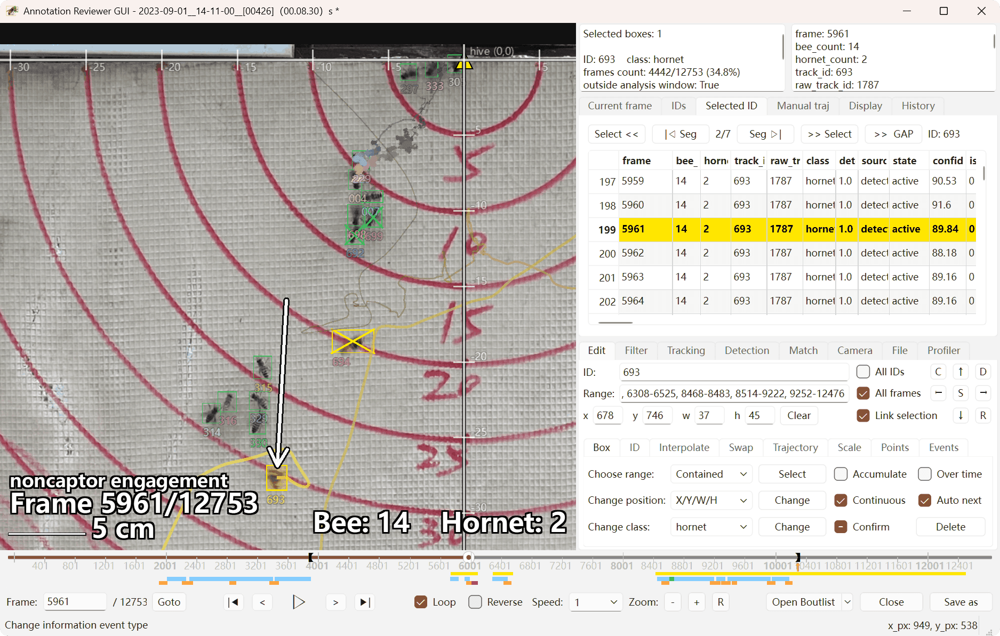

动物行为标注审阅与编辑工具 Annotation Reviewer 在开放源代码之前的试用通道。

- [下载程序](https://github.com/trhy123/annotation-reviewer-release/releases)
- [查看用户操作手册](docs/00_操作手册.md)
- [查看架构与数据约定文档](ARCHITECTURE.md)

请在 Releases 中选择版本和平台下载。离线用户文档 PDF 也在 Release 的附件中。
使用同一版本的 `SHA256SUMS.txt` 校验平台压缩包；分卷包请同时下载该版本的重组说明。
各版本标签保留对应版本的文档；仓库自动生成的 Source code 压缩包只包含本仓库的文档。

此仓库用于提供试用程序和文档，源代码仓库尚未开放。

---

# Annotation Reviewer



跨平台 Qt 视频标注审核工具，包含独立打包的 YOLO `DetectionWorker`。程序用于视频播放、标注呈现与编辑、手工轨迹对齐匹配、检测结果审核及带标注视频导出。每视频一个 SQLite 结果文件，包含 raw、final、metadata 和历史命令；旧 CSV 可导入。Save 写回当前 SQLite，Save as 默认带日期时间，可另存 SQLite 或兼容导出旧 CSV。

## 主要功能

- 视频播放、暂停、逐帧、跳转和循环播放
- 自动检测框、轨迹、ID、坐标轴及人工轨迹叠加显示
- OpenGL 高性能标注预览，以及 Qt/OpenCV CPU 稳定回退
- 自动标注和手工标注表格浏览、选择、修改和保存
- 手工轨迹与自动轨迹的时空对齐和绑定
- 历史记录、恢复文件和缓存管理
- 调用独立 `DetectionWorker` 加载 Ultralytics YOLO `.pt` 模型
- CPU、NVIDIA CUDA 和 Apple Silicon MPS 推理
- FFmpeg 导出带标注视频

## 程序结构

```text
AnnotationReviewer-<platform>/
├─ AnnotationReviewer.exe / AnnotationReviewer.app
├─ _internal/                 # Windows/Linux GUI 运行库
├─ DetectionWorker/           # 独立的 YOLO 推理程序及运行库
├─ runtime/                   # 只存放共享媒体运行时
│  ├─ bin/                    # ffmpeg、ffprobe；Windows 的 libmpv/DLL 也在这里
│  ├─ lib/                    # macOS/Linux 的 libmpv 与共享库
│  └─ licenses/
├─ cache/                     # 可删除的应用缓存与恢复数据
│  ├─ recovery/
│  └─ overlay_layers/
├─ settings.ini
├─ presets_detection/         # GUI 与 DetectionWorker 共用的检测预设
├─ models/
├─ detection_results/
└─ BUILD_INFO.json
```

GUI 不包含 PyTorch、Ultralytics 或 scikit-image；模型推理由 `DetectionWorker` 承载。GUI 使用 SciPy 支持轨迹插值、平滑等功能。因此检测进程的启动、退出或显存错误不会直接破坏 GUI 进程。

架构及后端边界见 [`ARCHITECTURE.md`](ARCHITECTURE.md)。

## 视频与标注后端

### 视频播放

- `mpv_gl`：发布模板的优先模式，使用 `libmpv` 向 OpenGL 输出视频画面。
- `cpu_frames + FFmpeg`：使用 `runtime/bin/ffmpeg` 解码帧。
- `cpu_frames + OpenCV`：不依赖外部 FFmpeg 的回退解码路径。

旧的 `mpv_native` 窗口嵌入模式不作为正式支持模式。

### 标注呈现

- `OpenGL`：高性能预览路径。
- `Qt/OpenCV CPU`：不依赖 CUDA 的稳定回退路径。

当前发布版 GUI 不打包 PyTorch。Windows CUDA 版本中的“CUDA”指 `DetectionWorker` 使用 CUDA 进行 YOLO 推理。

### OpenCV

Windows、macOS 和 Linux 的 GUI 与 DetectionWorker 均使用 `opencv-python-headless`。它提供视频读取、颜色转换、缩放、几何变换和 CPU 图像处理；程序窗口由 Qt 提供，因此不需要 OpenCV 的独立窗口组件。

## 共享媒体运行时

构建脚本会从 [`trhy123/annotation-reviewer-media-runtime`](https://github.com/trhy123/annotation-reviewer-media-runtime) 的 Release 下载已经编译好的平台运行时，并整体放入 `runtime/`。

运行时包含：

```text
libmpv + ffmpeg + ffprobe + 共用的 FFmpeg/libav* 动态库
```

主程序构建不会重新编译 FFmpeg 或 mpv。只有媒体运行时本身需要更新时，才在独立仓库重新构建一次；之后的 Annotation Reviewer 构建只下载并打包已发布的 runtime。

默认选择最新一个同时包含 Windows、macOS arm64、macOS Intel 和 Linux 四个平台资产的完整 runtime Release。需要固定版本以获得完全可复现构建时，可设置：

```text
AR_MEDIA_RUNTIME_TAG=<runtime release tag>
```

或调用：

```text
python packaging/build_release.py ... --media-runtime-tag <tag>
```

构建时会校验 GitHub Release 资产提供的 SHA-256，并自动写入 `settings.ini`：

```ini
[playback]
libmpv_path=runtime/...

[decoder]
ffmpeg_path=runtime/bin/ffmpeg[.exe]
ffprobe_path=runtime/bin/ffprobe[.exe]

[export]
ffmpeg_path=runtime/bin/ffmpeg[.exe]
```

Windows GUI 启动时通过 `os.add_dll_directory()` 将 `runtime/bin` 加入 DLL 搜索目录，使 `libmpv` 能找到同目录下的共享 FFmpeg 与其他依赖 DLL。

没有 runtime 时仍可使用 OpenCV CPU 预览，但 `mpv_gl`、FFmpeg 解码、精确 ffprobe PTS 索引和视频导出会按相应依赖不可用的方式回退或报错。

## 配置文件

源码包含三个平台模板：

```text
settings.windows.ini
settings.macos.ini
settings.linux.ini
```

构建时只复制当前平台模板，并改名为发布目录中的 `settings.ini`，随后自动写入当前 runtime 的实际相对路径。直接运行源码时，若不存在 `settings.ini`，程序会按当前系统从相应模板生成。

`settings.ini` 保存外部程序路径、模型路径、解码与渲染模式、窗口布局、表格列宽、标注样式及其他用户设置。恢复文件和 Overlay 缓存写入 `cache/`；`runtime/` 只用于媒体依赖。删除 `settings.ini` 会重置配置。

## 本地构建

构建脚本和依赖清单位于 `packaging/`。

### Windows x64

要求：64 位 Python 3.12 和 7-Zip。

```text
packaging\build_release.cmd
```

默认构建 CUDA/CPU 兼容的 DetectionWorker，并自动加入已发布的共享 media runtime。构建 CPU-only worker：

```powershell
.\packaging\build_release.ps1 -WorkerFlavor cpu
```

不加入 media runtime：

```powershell
.\packaging\build_release.ps1 -SkipMediaRuntime
```

固定 runtime Release：

```powershell
.\packaging\build_release.ps1 -MediaRuntimeTag runtime-ci-XX
```

### macOS / Linux

```bash
./packaging/build_release.sh
```

macOS 也可运行：

```text
packaging/build_release.command
```

构建过程会在项目根目录产生：

```text
.build-envs/     # 可删除的构建虚拟环境
build-output/    # 可删除的 PyInstaller 中间文件
release/         # 最终目录和压缩包
```

## 版本发布

所有版本都具备相同的应用功能，只是 YOLO 检测器的硬件加速推理方式有区别：CUDA 版本支持在 NVIDIA GPU 和 CPU 上进行推理处理，而 CPU 版本则仅支持在 CPU 上进行处理。对于 macOS 系统，如果硬件支持 Metal 框架，原生版本还支持通过 GPU 进行加速处理。如不需要或无法使用 NVIDIA GPU 进行推理，下载 CPU 版本即可。

Actions 的 `Optional release tag; blank uses build-<run number>` 同时决定 Release tag、发布目录和下载文件的版本后缀。例如输入 `0.55`，Windows CPU 版生成 `AnnotationReviewer-windows-amd64-cpu-0.55/` 和同名 `.zip`；CUDA 版使用同样后缀的 `.7z`。留空时使用 `build-<run number>`。Actions artifact 名称同样包含该后缀。

本地构建可传入 `python packaging/build_release.py --release-tag 0.55 --archive`，或设置 `AR_RELEASE_TAG` 环境变量。未设置版本的本地构建保留无版本后缀。版本只使用字母、数字、点、下划线、加号或连字符，以便跨平台作为文件名，不能以点结尾。

## 平台兼容性

- Windows：64 位 Windows 10 1809 或更新版本、Windows 11
- macOS：macOS 13 Ventura 或更新版本；分别提供 Apple Silicon 和 Intel 构建
- Linux：x86-64，建议 Ubuntu 22.04 或具有相近/更新 glibc 的发行版

不维护 32 位、Windows 7、Windows 8.1 版本或单独的 macOS 12 兼容构建。

## 使用说明

参见 [操作手册](docs/00_操作手册.md)，各功能说明独立成文件。
