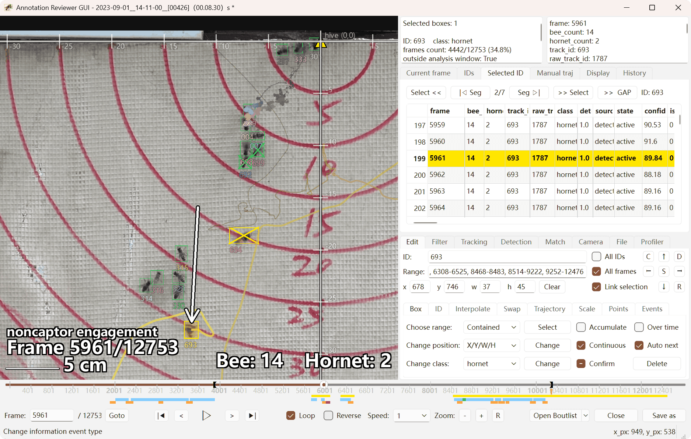

Annotation Reviewer trial downloads and documentation.

- [Download the application](https://github.com/trhy123/annotation-reviewer-release/releases)
- [English user manual](docs/en/00_Annotation_Reviewer_User_Manual.md)
- [中文操作手册](docs/zh/00_操作手册.md)

Choose a release and platform in Releases. Offline manual PDFs are attached to releases when available.
Verify platform archives with SHA256SUMS.txt from the same release. Download every part of a split archive and follow its reassembly instructions.
Version tags retain the matching documentation. GitHub's automatically generated Source code archives contain only this repository's documentation.

This repository distributes trial builds and documentation; the application source repository is not yet public.

---

# Annotation Reviewer

English | [中文](README_zh.md)



A cross-platform Qt application for reviewing video annotations, with a separately packaged YOLO `DetectionWorker`. It supports video playback, annotation display and editing, manual-trajectory alignment and matching, detection review, and annotated-video export. Each video has one SQLite result file containing raw data, final annotations, metadata, and command history. Existing CSV files can be imported. Save updates the current SQLite file; Save as adds a timestamp by default and can write SQLite or export a compatible CSV file.

## Main Features

- Video playback, pause, frame stepping, seeking, and looping
- Detection boxes, trails, IDs, coordinate axes, and manual-trajectory overlays
- High-performance OpenGL annotation previews and a Qt/OpenCV CPU fallback
- Browsing, selecting, editing, and saving automatic and manual annotations in tables
- Opening files through startup arguments, or jumping to a segment and selecting IDs from a review queue or target arguments; neither requires a Boutlist. See the [navigation interface](docs/en/01_Basic_Operations.md#135-review-queue-and-navigation-interface)
- Spatial and temporal alignment and binding of manual and automatic trajectories
- Command history, recovery files, and cache management
- Loading Ultralytics YOLO `.pt` models through the independent `DetectionWorker`
- CPU, NVIDIA CUDA, and Apple Silicon MPS inference
- Annotated-video export through FFmpeg

## Application Layout

Windows and Linux use a portable folder with sibling components:

```text
AnnotationReviewer-<platform>/
├─ AnnotationReviewer.exe / AnnotationReviewer  # Main application
├─ _internal/                                   # Main application libraries
├─ DetectionWorker/                             # Detection executable and libraries
├─ runtime/{bin,lib,licenses}/                  # FFmpeg, FFprobe, and libmpv
├─ settings.ini                                 # User configuration
├─ presets_detection/                           # Detection postprocessing presets
├─ cache/{overlay_layers,pts,recovery}/         # Caches and recovery data
└─ models/                                      # Model weights
```

The macOS portable package contains all executable dependencies inside the `.app`:

```text
AnnotationReviewer-macos-<arch>/
├─ AnnotationReviewer.app/Contents/
│  ├─ MacOS/AnnotationReviewer
│  ├─ Helpers/{DetectionWorker.app,media-runtime/bin/}
│  ├─ Frameworks/                               # Python, Qt, media-runtime/lib, etc.
│  └─ Resources/                                # Default configuration, presets, licenses
├─ settings.ini                                 # User configuration
├─ presets_detection/                           # Detection postprocessing presets
├─ cache/{overlay_layers,pts,recovery}/         # Caches and recovery data
├─ models/                                      # Model weights
└─ cleanup_macos.command                        # macOS shared configuration cleanup script
```

**Moving the entire macOS portable folder** preserves the sibling `settings.ini` as the preferred configuration. Relative paths for models, editable presets, caches, and results are resolved against that folder. **Moving only the `.app`**, when its new location has no sibling configuration, uses `~/Library/Application Support/AnnotationReviewer/` for configuration and user data, and `~/Library/Caches/AnnotationReviewer/` for the default system cache. Explicit cache paths in an existing configuration take precedence. The application does not write user data into the signed `.app` and does not require an external runtime or Worker.


The GUI does not bundle PyTorch, Ultralytics, or scikit-image; model inference runs in `DetectionWorker`. The GUI uses SciPy for trajectory interpolation and smoothing. Starting or stopping detection, or a GPU-memory error in detection, therefore does not directly bring down the GUI process.


## Video and Annotation Backends

### Video Playback

- `mpv_gl`: the preferred mode in release templates; renders video through `libmpv` and OpenGL.
- `cpu_frames + FFmpeg`: decodes frames using `runtime/bin/ffmpeg`.
- `cpu_frames + OpenCV`: a fallback decoder that does not require an external FFmpeg executable.

The former `mpv_native` embedded-window mode is not a supported release mode.

### Annotation Rendering

- `OpenGL`: high-performance previews.
- `Qt/OpenCV CPU`: a fallback that does not require CUDA.

The release GUI does not bundle PyTorch. “CUDA” in the Windows CUDA package means that `DetectionWorker` can use CUDA for YOLO inference.

### OpenCV

The GUI and DetectionWorker use `opencv-python-headless` on Windows, macOS, and Linux. It provides video reading, color conversion, resizing, geometric transforms, and CPU image processing. Qt supplies application windows, so OpenCV's separate window components are unnecessary.

## Shared Media Runtime

The build script downloads precompiled platform runtimes from the Releases of [`trhy123/annotation-reviewer-media-runtime`](https://github.com/trhy123/annotation-reviewer-media-runtime). It places them in `runtime/` on Windows/Linux, or in the appropriate Helpers, Frameworks, and Resources directories inside the macOS `.app/Contents/`.

The runtime contains:

```text
libmpv + ffmpeg + ffprobe + shared FFmpeg/libav* libraries
```

Building the main application does not recompile FFmpeg or mpv. Rebuild the media runtime in its separate repository only when it needs an update; subsequent Annotation Reviewer builds download and package the published runtime.

By default, the build selects the latest complete runtime Release containing assets for Windows, macOS arm64, macOS Intel, and Linux. To pin a version for reproducible builds, set:

```text
AR_MEDIA_RUNTIME_TAG=<runtime release tag>
```

Or run:

```text
python packaging/build_release.py ... --media-runtime-tag <tag>
```

The build verifies the SHA-256 provided for each GitHub Release asset and writes the following paths to `settings.ini`:

```ini
[playback]
libmpv_path=runtime/...

[decoder]
ffmpeg_path=runtime/bin/ffmpeg[.exe]
ffprobe_path=runtime/bin/ffprobe[.exe]

[export]
ffmpeg_path=runtime/bin/ffmpeg[.exe]
```

On Windows, the GUI adds `runtime/bin` to the DLL search path with `os.add_dll_directory()` so that `libmpv` can locate the shared FFmpeg libraries and other dependencies in that directory.

Without the runtime, OpenCV CPU previews remain available. Features that require `mpv_gl`, FFmpeg decoding, precise FFprobe PTS indexing, or video export fall back or report unavailable dependencies as appropriate.

## Configuration

The source includes three platform templates:

```text
settings.windows.ini
settings.macos.ini
settings.linux.ini
```

Each platform build supplies an editable sibling `settings.ini`. macOS also retains a read-only template at `Contents/Resources/settings.macos.ini` to initialize user configuration when only the `.app` is moved. When running from source, a missing configuration is initialized from the current platform's template. Parameters absent from that template use one shared set of code defaults across operating systems.

The shared code defaults are: 4 decoding threads, 4 Detection FFmpeg threads, 2 prediction workers, YOLO batch size 8, a 48-frame playback queue with a 64-frame buffer, and 128 MiB for each of the two Overlay caches. Platform templates and saved user values take precedence; existing configurations are not automatically overwritten.

`settings.ini` stores external executable paths, model paths, decoding and rendering modes, window layout, table column widths, annotation styles, and other preferences. Recovery files and Overlay caches are written to `cache/`; `runtime/` is reserved for media dependencies. Deleting `settings.ini` resets the configuration.

## Local Builds

Build scripts and dependency lists are in `packaging/`.

### Windows x64

Requirements: 64-bit Python 3.12 and 7-Zip.

```text
packaging\build_release.cmd
```

The default build includes a CUDA/CPU-compatible DetectionWorker and the published shared media runtime. To build a CPU-only Worker:

```powershell
.\packaging\build_release.ps1 -WorkerFlavor cpu
```

To omit the media runtime:

```powershell
.\packaging\build_release.ps1 -SkipMediaRuntime
```

To pin a runtime Release:

```powershell
.\packaging\build_release.ps1 -MediaRuntimeTag runtime-ci-XX
```

### macOS / Linux

```bash
./packaging/build_release.sh
```

On macOS, you can also run:

```text
packaging/build_release.command
```

Builds create these directories in the project root:

```text
.build-envs/     # Disposable build virtual environments
build-output/    # Disposable PyInstaller intermediate files
release/         # Final application folders and archives
```

## Releases

[Download Annotation Reviewer](https://github.com/trhy123/annotation-reviewer-release/releases)

All packages provide the same application features; they differ in the hardware acceleration available for YOLO inference. CUDA packages support NVIDIA GPU and CPU inference, while CPU packages use the CPU. Native macOS builds also support GPU inference through Metal when the hardware supports it. Choose a CPU package if you do not need or cannot use NVIDIA GPU inference.

The Actions input `Optional release tag; blank uses build-<run number>` sets the Release tag, application-folder suffix, and archive version suffix. For example, `0.55` produces `AnnotationReviewer-windows-amd64-cpu-0.55/` and a matching `.zip` for the Windows CPU build; the CUDA build uses the same suffix with `.7z`. Leaving it blank uses `build-<run number>`. Actions artifact names include that suffix too.

For local builds, pass `python packaging/build_release.py --release-tag 0.55 --archive`, or set `AR_RELEASE_TAG`. Local builds without a version retain unversioned names. Versions may contain letters, digits, dots, underscores, plus signs, and hyphens, and must not end in a dot, so that they remain valid cross-platform filenames.

## Platform Compatibility

- Windows: 64-bit Windows 10 version 1809 or later, and Windows 11.
- macOS: macOS 13 Ventura or later; separate Apple Silicon and Intel builds.
- Linux: x86-64, built against Ubuntu 22.04 (glibc 2.35). Older glibc versions and all Linux distributions are not guaranteed to work. Desktops need Qt's X11/xcb or Wayland dependencies and working OpenGL drivers.

There are no maintained 32-bit, Windows 7, Windows 8.1, or separate macOS 12 builds.

The public build workflow includes path and configuration tests for Windows, macOS, and Ubuntu 22.04/24.04. Clear all platform-build selections to run only source checks. Post-build checks verify GUI imports, the Worker JSON protocol, and media dependency loading from another working directory. Linux media-runtime checks also run without `LD_LIBRARY_PATH`. These checks do not replace real-desktop testing of playback, precise seeking, detection, export, and saving.

## Languages and Documentation

See the [English user manual](docs/en/00_Annotation_Reviewer_User_Manual.md) or [中文操作手册](docs/zh/00_操作手册.md). Each feature has its own chapter.

The interface defaults to English. Select Simplified Chinese in Display → Others → Language, save settings, and restart to apply it. The Classes table lets you maintain model class numbers, names, and descriptions directly. Event and review descriptions and dropdown labels are editable project settings in `settings.ini`.

Merge manuals interactively with `python docs/build_manual.py`, or pass `--docs docs/en --output "AnnotationReviewer_User_Manual.md"` (use `docs/zh` for Chinese). Project resources remain linked to their original files.
